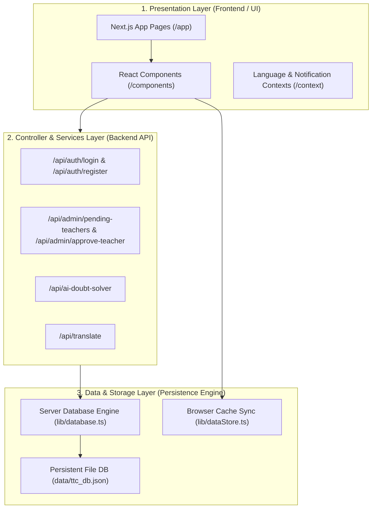

# 🏗️ Talent Tuition Center (TTC) - System Architecture & Separation of Concerns Specification

> **Version:** 2.0 Production Release  
> **Pattern:** 3-Tier Layered Micro-Services Architecture  
> **Deployment Target:** Containerized Docker & Orchestrated Docker Compose  

---

## 📐 1. System High-Level Architecture Overview

The system strictly decouples the **Frontend Presentation Layer**, **Backend API Controllers**, and **Data Persistence Engine**, ensuring enterprise-grade maintainability, security, and scalability.



---

## 🗂️ 2. Architectural Division & Directory Map

```
TTC/
├── backend/                         <-- BACKEND APPLICATION & SERVICE LAYER
│   ├── controllers/                 <-- API Request Controllers & Business Logic
│   │   ├── authController.ts        <-- Registration, Sign-In & Hashing Logic
│   │   └── adminController.ts       <-- Pending Teacher Approvals & Permissions
│   └── database/                    <-- Server Database & Data Access Objects (DAO)
│       └── db.ts                    <-- Persistent JSON Database Service (ttc_db.json)
│
├── components/                      <-- FRONTEND REUSABLE COMPONENTS LAYER
│   ├── GoogleLoginButton.tsx        <-- Google Identity SSO Component
│   ├── TeacherApprovalPanel.tsx     <-- Admin Permission & Approval Panel
│   ├── PublicHeader.tsx             <-- Dynamic Public Navigation
│   └── PublicFooter.tsx             <-- Brand Footer & Quick Links
│
├── context/                         <-- FRONTEND STATE & PROVIDERS
│   ├── LanguageContext.tsx          <-- Multi-language Context (EN, KN, HI)
│   └── NotificationContext.tsx      <-- Real-time Toast & Notification Context
│
├── app/                             <-- FRONTEND PAGES & HTTP ROUTER ADAPTERS
│   ├── about/                       <-- Public About Us Page
│   ├── classes/                     <-- Courses & Schedules Page
│   ├── contact/                     <-- Admission Enquiry Page
│   ├── faq/                         <-- Helpdesk Page
│   ├── login/                       <-- Auth Page (Sign In & Sign Up)
│   ├── portal/                      <-- Protected Portal (RBAC Dashboard)
│   └── api/                         <-- THIN HTTP ROUTER ADAPTERS
│       ├── auth/
│       │   ├── login/route.ts       <-- Delegates to AuthController.login()
│       │   └── register/route.ts    <-- Delegates to AuthController.register()
│       └── admin/
│           ├── pending-teachers/    <-- Delegates to AdminController.getPendingTeachers()
│           └── approve-teacher/     <-- Delegates to AdminController.approveTeacher()
```
│       │   ├── pending-teachers/    <-- Pending Teacher Review API
│       │   └── approve-teacher/     <-- Admin Authorization Controller
│       ├── ai-doubt-solver/         <-- Gemini Multimodal Solver API
│       └── translate/               <-- i18n Translation API
├── components/                      <-- REUSABLE FRONTEND COMPONENTS
│   ├── GoogleLoginButton.tsx        <-- Google Identity SSO Component
│   ├── TeacherApprovalPanel.tsx     <-- Admin Permission & Approval Panel
│   ├── PublicHeader.tsx             <-- Dynamic Public Navigation
│   ├── PublicFooter.tsx             <-- Brand Footer & Quick Links
│   ├── WorkflowTab.tsx              <-- Academic Workflow Engine
│   └── LiveMCQTrackingDashboard.tsx <-- Real-time Test Tracking Engine
├── lib/                             <-- 3. BUSINESS LOGIC & DATA LAYER
│   ├── database.ts                  <-- Server DB Service (SHA-256 Hashing, User CRUD)
│   ├── dataStore.ts                 <-- Client Data Engine & Session Guards
│   └── translations.ts              <-- Multi-language Dictionary (EN, KN, HI)
├── data/                            <-- PERSISTENT DATABASE STORAGE
│   └── ttc_db.json                  <-- Server JSON Database File
├── Dockerfile                       <-- Multi-Stage Production Docker Build
└── docker-compose.yml               <-- Orchestration with Persistent Data Volume
```

---

## 🔐 3. Security & Role-Based Access Control (RBAC)

1. **Authentication Layer:** Passwords are SHA-256 hashed with salt on the server side prior to DB write.
2. **Session Protection:** Tokens carry a 24-hour expiration window (`expiresAt`).
3. **Role Boundaries:**
   - **Student:** `overview`, `notifications`, `workflow`, `timetable`, `results`, `myFees`, `doubts`.
   - **Teacher:** `overview`, `notifications`, `workflow`, `myClasses`, `students` (fee details sanitized), `attendance`, `results`, `doubts`. Requires Admin authorization (`status: pending`).
   - **Admin:** Full access across all 10 portal tabs + `TeacherApprovalPanel`.

---

## 🐳 4. Docker Containerization & Deployment

### Production Multi-Stage Dockerfile Highlights:
- **Base:** Node 20 Alpine Linux (Minimal attack surface).
- **Security:** Runs as non-root system user (`nextjs:nodejs`).
- **Optimization:** Standalone Next.js bundle output (~120MB image size).
- **Persistence:** Volume mount at `/app/data` ensures user accounts persist across container restarts.

### Quick Launch Commands:
```bash
# Build and run containerized application via Docker Compose
docker-compose up -d --build

# View container logs
docker-compose logs -f

# Check container health status
docker-compose ps
```
