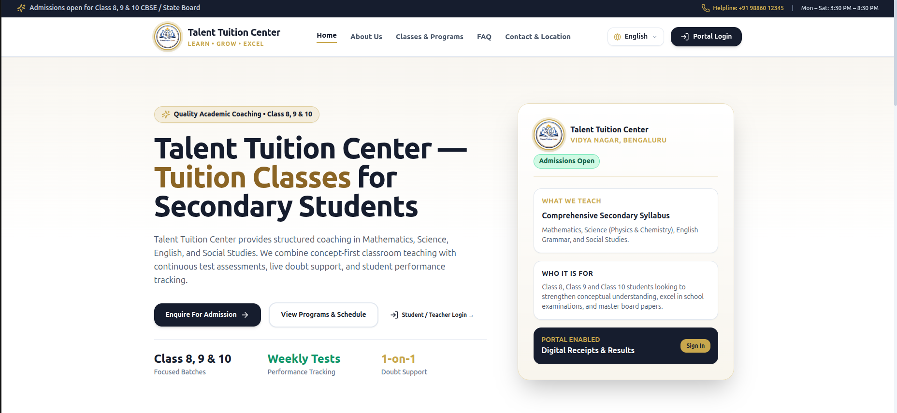
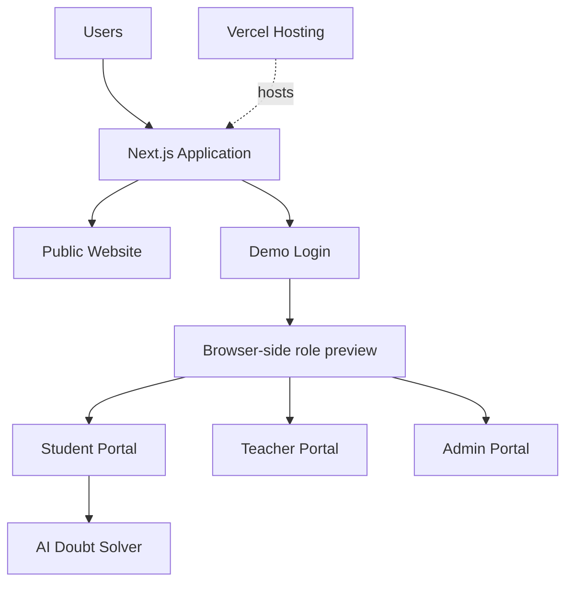
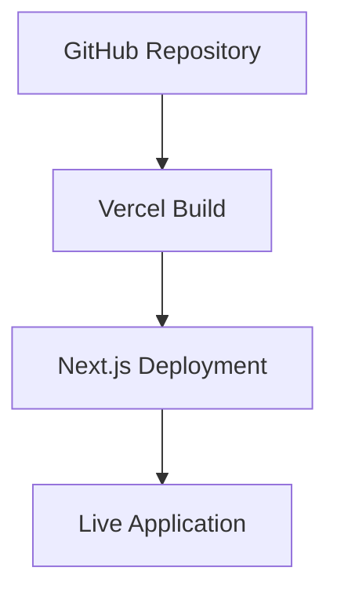

<div align="center">


# 🎓 Talent Tuition Center

### Digital Tuition Management Platform

**Learn • Grow • Excel**

[](https://github.com/9harshithp/talent-tuition-center/actions/workflows/ci.yml)
[](https://talent-tuition-center.vercel.app/)
[](https://nextjs.org/)
[](https://www.typescriptlang.org/)
[](https://talent-tuition-center.vercel.app/)

</div>

---

## 🖥️ Application Showcase

<div align="center">

[](https://talent-tuition-center.vercel.app/)

*Modern digital education platform for secondary students.*

[](https://talent-tuition-center.vercel.app/)

</div>

---

## 📌 Project Overview

Talent Tuition Center is a web-based tuition management platform designed to digitalize academic coaching, student management, teacher coordination and administrative activities.

The platform focuses on students studying Classes 8, 9 and 10 under CBSE and State Board curricula.

It combines a public-facing educational website with dedicated Student, Teacher and Administrator portal experiences.

**Live website:** https://talent-tuition-center.vercel.app/

---

## 🎯 Project Objectives

- Digitalize tuition center operations.
- Simplify student and teacher management.
- Improve academic performance tracking.
- Provide structured access to educational information.
- Demonstrate AI-assisted learning workflows.
- Create a responsive and accessible user experience.

---

## 🌟 Platform Features

| Module | Features |
|---|---|
| Public Website | Admissions, academic programs, contact information and FAQs |
| Student Portal | Academic information, results and learning resources |
| Teacher Portal | Academic management and teacher approval workflows |
| Admin Portal | Student and teacher administration |
| AI Assistance | Gemini-powered doubt-solving experience |
| Digital Management | Results and receipt management |
| Responsive Design | Desktop, tablet and mobile interfaces |

---

## 💻 Technology Stack

<div align="center">


</div>

| Layer | Technology |
|---|---|
| Application Framework | Next.js |
| Frontend | React |
| Programming Language | TypeScript |
| Styling | Tailwind CSS |
| AI Integration | Google Gemini |
| Containerization | Docker |
| Deployment | Vercel |
| Version Control | Git and GitHub |

---

## 🏗️ System Architecture

### Current Preview Architecture



The current version demonstrates the application interface and role-specific workflows using a browser-based preview.

---

## 👥 User Roles

### 🎓 Student

- Access academic information.
- View learning resources.
- Explore performance information.
- Use AI-assisted doubt-solving features.

### 👨‍🏫 Teacher

- Explore academic management workflows.
- Manage student-related activities.
- Participate in teacher approval workflows.

### ⚙️ Administrator

- Explore student and teacher administration.
- Access administrative dashboard previews.
- Manage academic and fee-related workflows.

---

## 🗄️ Proposed Production Data Model

```mermaid
erDiagram
    USER ||--o| STUDENT : represents
    USER ||--o| TEACHER : represents
    STUDENT ||--o{ RESULT : receives
    STUDENT ||--o{ FEE_RECORD : has
    TEACHER ||--o{ CLASS : teaches
    CLASS ||--o{ RESULT : generates
```

This diagram represents the proposed production database design. The current preview does not implement a production database-backed authentication system.

---

## 🚀 Local Development

### Prerequisites

- Node.js
- npm
- Git

### 1. Clone the Repository

```bash
git clone https://github.com/9harshithp/talent-tuition-center.git
cd talent-tuition-center
```

### 2. Install Dependencies

```bash
npm install
```

### 3. Start the Development Server

```bash
npm run dev
```

### 4. Open the Application

```text
http://localhost:3000
```

### 5. Create a Production Build

```bash
npm run build
```

---

## ☁️ Deployment

Talent Tuition Center is deployed using Vercel.



| Component | Platform |
|---|---|
| Application | Next.js |
| Source Control | GitHub |
| Hosting | Vercel |

**Production website:** https://talent-tuition-center.vercel.app/

---

## 🔐 Production Readiness

The current application is a functional preview.

Before processing real student information or payment records, the following improvements are required:

- Production authentication.
- Database-backed user accounts.
- Server-side role-based authorization.
- Admin-only access to financial information.
- Secure AI API configuration.
- Persistent academic records.
- Automated testing.
- CI/CD quality checks.

Browser-side role switching and hidden interface elements are not substitutes for server-side authorization.

---

## 🛣️ Development Roadmap

- [x] Responsive public website
- [x] Student portal preview
- [x] Teacher portal preview
- [x] Administrator portal preview
- [x] Vercel deployment
- [ ] Production authentication
- [ ] Persistent database integration
- [ ] Server-side authorization
- [ ] Automated test suite
- [ ] GitHub Actions CI/CD

---

## 🤝 Contributions

Suggestions and improvements are welcome through GitHub issues and pull requests.

---

## 👨‍💻 Developer

<div align="center">

### Harshith P

Backend Engineer | Full Stack Developer

[](https://github.com/9harshithp)
[](https://www.linkedin.com/in/harshithp914)
[](mailto:harshithp914@gmail.com)

⭐ If you find this project interesting, consider starring the repository.


</div>
